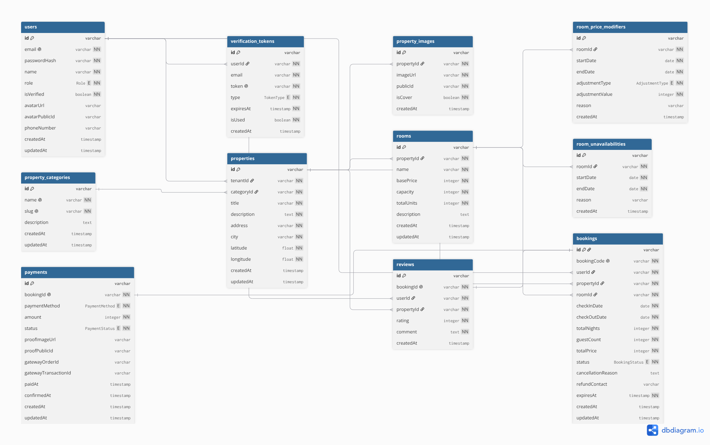

<div align="center">

# 🏡 SinggahIn
### *Property Rent App*

[](https://singgahin.biz.id)
[](https://www.typescriptlang.org/)
[](https://reactjs.org/)
[](https://vitejs.dev/)
[](https://nodejs.org/)
[](https://expressjs.com/)
[](https://www.postgresql.org/)
[](https://www.prisma.io/)
[](https://tailwindcss.com/)
[](https://www.docker.com/)

<br />

<p align="center">
  <b>SinggahIn</b> adalah platform reservasi penginapan <i>two-sided marketplace</i> modern yang mempertemukan <b>Tamu (Penyewa)</b> dengan <b>Pemilik Properti (Tenant)</b>. Dibangun dengan pendekatan <i>mobile-first</i>, arsitektur <i>Domain-Driven Design</i> (DDD), serta optimasi SEO tingkat lanjut, SinggahIn menghadirkan solusi transparansi tarif menginap melalui sistem komparasi kalender interaktif dan penyesuaian harga musiman otomatis (<i>Dynamic Peak Season Rates</i>).
</p>

[🌐 Kunjungi Website](https://singgahin.biz.id) • [✨ Fitur Unggulan](#-fitur-unggulan) • [🏗️ Arsitektur & Tech Stack](#️-arsitektur--tech-stack) • [🗺️ Skema Basis Data (ERD)](#️-skema-basis-data-erd) • [🚀 Panduan Instalasi](#-panduan-instalasi--menjalankan-aplikasi) • [🧪 Pengujian](#-pengujian-otomatis)

---

</div>

## 📌 Daftar Isi

1. [Latar Belakang & Nilai Bisnis](#-latar-belakang--nilai-bisnis)
2. [Fitur Unggulan](#-fitur-unggulan)
   - [Pengalaman Tamu (Penyewa)](#1-pengalaman-tamu-penyewa)
   - [Pusat Pengelolaan Tenant](#2-pusat-pengelolaan-tenant-pemilik-properti)
   - [Sistem Pembayaran & Transaksi](#3-sistem-pembayaran--transaksi)
   - [Keandalan Platform & SEO](#4-keandalan-platform--optimasi-seo)
3. [Arsitektur & Tech Stack](#️-arsitektur--tech-stack)
4. [Skema Basis Data (ERD)](#️-skema-basis-data-erd)
5. [Struktur Repositori](#-struktur-repositori)
6. [Panduan Instalasi & Menjalankan Aplikasi](#-panduan-instalasi--menjalankan-aplikasi)
   - [Prasyarat Sistem](#prasyarat-sistem)
   - [Konfigurasi Environment Variables](#konfigurasi-environment-variables)
   - [Menjalankan dengan Docker Compose (Direkomendasikan)](#opsi-1-menjalankan-dengan-docker-compose-direkomendasikan)
   - [Menjalankan Secara Lokal (Development)](#opsi-2-menjalankan-secara-lokal-development)
7. [Pengujian Otomatis](#-pengujian-otomatis)
8. [Dokumentasi RESTful API](#-dokumentasi-restful-api)
9. [Kontributor & Lisensi](#-kontributor--lisensi)

---

## 💡 Latar Belakang & Nilai Bisnis

Industri persewaan properti sering menghadapi kendala klasik: ketidakpastian harga saat musim liburan, risiko pesanan ganda (*double booking*), serta proses pencatatan reservasi manual yang rentan kesalahan. **SinggahIn** hadir menjawab tantangan tersebut dengan tiga pilar nilai utama:

* **Transparansi Tarif Real-Time**: Calon penyewa dapat memantau pergerakan harga menginap harian dalam kalender visual 1 bulan penuh tanpa biaya tersembunyi.
* **Optimalisasi Pendapatan Mitra (RevPAR)**: Tenant dapat mengatur tarif khusus liburan (*peak season rates*) baik berupa persentase maupun nominal tetap untuk memaksimalkan okupansi dan pendapatan.
* **Reservasi Bebas Bentrok (*Zero Double-Booking*)**: Transaksi database atomik memastikan ketersediaan unit kamar terverifikasi secara akurat pada rentang tanggal *check-in* hingga *check-out*.

---

## ✨ Fitur Unggulan

### 1. Pengalaman Tamu (Penyewa)
* **Pencarian Cerdas & Responsif**: Eksplorasi properti berdasarkan destinasi kota, rentang tanggal menginap, jumlah tamu, dan kategori akomodasi (Hotel, Villa, Apartemen, Homestay).
* **Kalender Harga Interaktif 1 Bulan**: Pratinjau tarif kamar per malam langsung pada halaman detail, memudahkan pemilihan tanggal paling hemat.
* **Alur Reservasi Cepat**: Formulir pemesanan yang ringkas dengan rincian biaya transparan sebelum pembayaran.
* **Manajemen Pesanan Terpadu**: Halaman riwayat pesanan dengan filter status lengkap (*Menunggu Pembayaran*, *Menunggu Konfirmasi*, *Dikonfirmasi*, *Selesai*, *Dibatalkan*, dan *Ditolak*).
* **Ulasan Terverifikasi**: Sistem testimoni dan penilaian bintang (1–5) satu arah yang hanya terbuka setelah masa menginap selesai (*Completed Stay*).

### 2. Pusat Pengelolaan Tenant (Pemilik Properti)
* **Manajemen Inventaris Properti & Kamar**: Penambahan dan pembaruan informasi fasilitas, foto galeri resolusi tinggi, penentuan foto cover utama, serta koordinat peta lokasi.
* **Penyesuaian Tarif Musiman (*Dynamic Peak Season Rates*)**: Atur penyesuaian harga khusus pada rentang tanggal tertentu (libur nasional, akhir pekan, atau musim liburan).
* **Fitur Penonaktifan Kamar (*Room Blocking*)**: Tenant dapat menandai kamar sebagai tidak tersedia untuk keperluan perawatan berkala atau renovasi.
* **Dasbor & Analitik Keuangan**: Grafik visual tren penjualan, pendapatan kotor/bersih per properti, serta matriks kalender okupansi kamar.
* **Verifikasi Bukti Pembayaran**: Area persetujuan (*approval*) atau penolakan (*rejection*) pembayaran transfer manual dengan alasan yang jelas bagi tamu.

### 3. Sistem Pembayaran & Transaksi
* **Metode Pembayaran Fleksibel**:
  * **Transfer Bank Manual**: Pengguna mengunggah bukti bayar (dengan validasi berkas ketat di sisi klien dan server, maks 1MB) yang diverifikasi langsung oleh tenant.
  * **Instant Payment Gateway (Midtrans Snap)**: Pembayaran otomatis instan via QRIS, GoPay, Virtual Account (BCA, BNI, BRI, Permata), dan Kartu Kredit.
* **Proteksi Status Transaksi & Anti Double-Click**: Tombol bayar otomatis dinonaktifkan (*disabled*) dengan indikator status verifikasi (*resolving loading*) saat pembayaran sedang diproses oleh gateway.
* **Invoice & Voucher PDF Otomatis**: Generator berkas PDF terstruktur (`pdfkit`) yang dilampirkan langsung pada email konfirmasi transaksi ke penyewa.
* **Scheduler Pembatalan Otomatis**: Background cron job (`node-cron`) yang secara berkala membatalkan pesanan yang melewati batas waktu pembayaran (*expired*).

### 4. Keandalan Platform & Optimasi SEO
* **Segregasi Peran Ketat (1 Akun = 1 Peran)**: Pengguna memiliki peran tunggal (`USER` atau `TENANT`) untuk menjamin keamanan transaksi dan integritas data. Halaman *Forbidden* (403) dan *Not Found* (404) dirancang profesional.
* **SEO & Social Share Preview Lengkap**: Pemanfaatan `react-helmet-async` untuk dynamic meta tags, Open Graph banner foto properti, Twitter Cards, serta Schema.org JSON-LD tipe `LodgingBusiness`.
* **Sitemap XML & Robots.txt Compliant**: Terkonfigurasi agar perayap mesin pencari (Googlebot) dapat mengindeks halaman publik secara optimal.

---

## 🏗️ Arsitektur & Tech Stack

SinggahIn dibangun dengan memisahkan domain secara tegas menggunakan prinsip **Clean Architecture & Domain-Driven Design (DDD)** pada backend, serta **Atomic Design System** pada frontend.

```
                              [ Klien Peramban ]
                                      │
                         (HTTPS / Mobile-First UI)
                                      ▼
                      [ Nginx Reverse Proxy + SSL ]
                         │                      │
                  /api/v1/*                     /*
                         ▼                      ▼
         [ Express.js Backend REST API ]   [ Vite + React SPA ]
           ├── Domain Modules (DDD)          ├── Atomic Components
           ├── JWT & RBAC Middleware         ├── TanStack Query v5
           ├── Multer Image Guard            ├── Zustand State Store
           ├── PDFKit Invoice Engine         └── React Helmet SEO
           ├── Prisma ORM 5.x
           └── PostgreSQL 16
```

### Rincian Teknologi

| Komponen | Teknologi | Keterangan & Peran |
|---|---|---|
| **Frontend Core** | React 18, Vite 5, TypeScript | Single Page Application berperforma tinggi |
| **Styling & UI** | Tailwind CSS 3.4, Lucide Icons | Antarmuka adaptif, clean, dan mobile-first |
| **State & Data Fetching** | TanStack Query v5, Zustand | Server-state caching dan client state management |
| **Validasi Skema** | Zod | Validasi data end-to-end (form frontend & DTO backend) |
| **SEO Management** | `react-helmet-async` | Dynamic Meta, Open Graph, dan JSON-LD Structured Data |
| **Backend Core** | Node.js 20+, Express.js, TypeScript | RESTful API berbasis Domain-Driven Layered Architecture |
| **Basis Data & ORM** | PostgreSQL 16 Alpine, Prisma ORM | Relasi data transaksional yang aman dan ACID-compliant |
| **Penyimpanan Media** | Cloudinary CDN SDK | Pengelolaan aset gambar avatar dan galeri properti |
| **Payment Gateway** | Midtrans Snap Engine | Pembayaran otomatis multi-kanal terintegrasi |
| **Email & Dokumen** | Nodemailer, PDFKit | Pengiriman email transaksi dan invoice PDF |
| **Task Scheduler** | `node-cron` | Background job pembatalan pesanan kadaluwarsa |
| **Container & Reverse Proxy** | Docker, Docker Compose, Nginx | Kontainerisasi penuh untuk kemudahan deployment |

---

## 🗺️ Skema Basis Data (ERD)

Desain relasi basis data mengedepankan integritas data relasional, pengindeksan komposit untuk kecepatan kueri pencarian ketersediaan, serta identifikasi unik berbasis CUID.

<div align="center">



</div>

### Entitas Kunci:
* `users`: Data akun (`USER` / `TENANT`), kredensial terenkripsi, serta profil pengguna.
* `verification_tokens`: Token sementara (TTL 1 jam) untuk aktivasi akun dan reset sandi.
* `properties`: Entitas utama properti mencakup judul, deskripsi, alamat, dan titik koordinat peta.
* `property_images`: Galeri foto properti di Cloudinary dengan penanda `isCover`.
* `rooms`: Definisi tipe kamar, kapasitas tamu, harga dasar harian, dan total inventaris unit.
* `room_price_modifiers`: Pengaturan kenaikan harga musiman (*peak rates*) berbasis rentang tanggal.
* `room_unavailabilities`: Periode penonaktifan unit kamar secara manual oleh tenant.
* `bookings`: Rekam transaksi reservasi, status alur pemesanan, dan batas waktu pembayaran.
* `payments`: Data pembayaran (metode, status, nomor VA, tautan bukti transfer, dan riwayat verifikasi).
* `reviews`: Ulasan dan rating bintang 1–5 dari tamu terverifikasi.

---

## 📁 Struktur Repositori

```text
singgahin/
├── backend/                       # Layanan Backend RESTful API
│   ├── prisma/                    # Skema Prisma & berkas seed database
│   ├── src/
│   │   ├── modules/               # Domain Bounded Contexts (DDD)
│   │   │   ├── identity/          # Modul autentikasi, akun & profil
│   │   │   ├── property/          # Modul listing & katalog properti
│   │   │   └── room/              # Modul kamar, pricing dinamis & kalender
│   │   ├── shared/                # Middleware umum, utility, dan service adapter (Mail, PDF, dll.)
│   │   └── index.ts               # Entry point server Express
│   ├── Dockerfile
│   └── package.json
├── frontend/                      # Aplikasi Klien Web
│   ├── src/
│   │   ├── components/            # Atomic Design System (atoms, molecules, organisms)
│   │   ├── modules/               # Domain-specific UI (booking, identity, payment, property, review)
│   │   ├── pages/                 # Halaman rute aplikasi
│   │   ├── stores/                # Zustand global state (auth, UI)
│   │   ├── libs/                  # Utilitas adapter (Axios, formatters, SEO helper)
│   │   └── App.tsx                # Routing & layout utama
│   ├── public/                    # Aset statis, robots.txt, dan sitemap.xml
│   ├── Dockerfile
│   └── package.json
├── nginx/                         # Konfigurasi Nginx Reverse Proxy & SSL
│   └── conf.d/default.conf
├── docs/                          # Berkas dokumentasi, PRD, dan ERD
├── docker-compose.yml             # Orkestrasi multi-container Docker
├── .env.example                   # Contoh berkas konfigurasi environment
└── README.md
```

---

## 🚀 Panduan Instalasi & Menjalankan Aplikasi

### Prasyarat Sistem
Pastikan perangkat Anda telah terpasang:
* [Git](https://git-scm.com/)
* [Node.js](https://nodejs.org/) (versi LTS v20.x ke atas) & `npm`
* [Docker Desktop](https://www.docker.com/) atau Docker Engine + Docker Compose

---

### Konfigurasi Environment Variables

Salin template berkas konfigurasi di direktori utama:

```bash
cp .env.example .env
```

Sesuaikan variabel penting di dalam `.env`:

```ini
PORT=5000
CLIENT_URL=http://localhost

# Kredensial Database PostgreSQL
POSTGRES_USER=postgres
POSTGRES_PASSWORD=postgres_secure_password
POSTGRES_DB=singgahin_db
POSTGRES_PORT=5432

# Keamanan JWT
JWT_SECRET=rahasia-jwt-singgahin-production-key
JWT_EXPIRES_IN=1d

# Integrasi Cloudinary CDN
CLOUDINARY_CLOUD_NAME=nama_cloud_anda
CLOUDINARY_API_KEY=api_key_anda
CLOUDINARY_API_SECRET=api_secret_anda

# Konfigurasi Email SMTP (Nodemailer)
SMTP_HOST=smtp.gmail.com
SMTP_PORT=587
SMTP_USER=email_anda@gmail.com
SMTP_PASS=app_password_anda
SMTP_FROM="SinggahIn <no-reply@singgahin.biz.id>"

# Payment Gateway Midtrans (Sandbox / Production)
MIDTRANS_SERVER_KEY=SB-Mid-server-xxxx
MIDTRANS_CLIENT_KEY=SB-Mid-client-xxxx
MIDTRANS_IS_PRODUCTION=false
```

---

### Opsi 1: Menjalankan dengan Docker Compose (Direkomendasikan)

Cukup satu perintah untuk menjalankan seluruh layanan (PostgreSQL, Backend, Frontend, dan Nginx):

```bash
# Build dan jalankan seluruh container di background
docker compose up -d --build

# Periksa status container yang berjalan
docker compose ps
```

Akses layanan melalui peramban:
* **Aplikasi Web**: [`http://localhost`](http://localhost)
* **API Backend**: [`http://localhost/api/v1/health`](http://localhost/api/v1/health)

Untuk mematikan container:
```bash
docker compose down
```

---

### Opsi 2: Menjalankan Secara Lokal (Development)

Jika ingin menjalankan aplikasi secara langsung di terminal lokal:

#### 1. Menjalankan Backend
```bash
cd backend
npm install

# Jalankan migrasi dan seeding database
npx prisma migrate dev --name init
npx ts-node prisma/seed.ts

# Jalankan server development
npm run dev
```
Backend berjalan di: `http://localhost:5000`

#### 2. Menjalankan Frontend
Buka terminal baru:
```bash
cd frontend
npm install

# Jalankan Vite development server
npm run dev
```
Frontend berjalan di: `http://localhost:5173`

---

## 🧪 Pengujian Otomatis

SinggahIn mengedepankan keandalan fungsionalitas dengan pengujian menyeluruh (Unit & Integration Testing) menggunakan Vitest, Supertest, dan React Testing Library:

```bash
# Menjalankan seluruh pengujian backend (414 tests)
npm test --prefix backend

# Menjalankan pengujian backend dengan laporan cakupan (coverage)
npm test --prefix backend -- --coverage

# Menjalankan seluruh pengujian frontend (394 tests)
npm test --prefix frontend -- --run
```

> **Status Pengujian**: Lebih dari **808 tests** berhasil lolos (100% pass rate) mencakup seluruh skenario kalkulasi tarif musiman, alur pembayaran, validasi berkas, dan otorisasi peran.

---

## 📡 Dokumentasi RESTful API

Seluruh endpoint diawali dengan prefix `/api/v1`:

| Modul | Metode | Endpoint | Deskripsi | Akses |
|---|---|---|---|---|
| **Identity** | `POST` | `/identity/register` | Pendaftaran akun baru via email verifikasi | Publik |
| | `POST` | `/identity/verify` | Verifikasi token dan penyetelan kata sandi | Publik |
| | `POST` | `/identity/login` | Masuk ke akun (menghasilkan HttpOnly cookie) | Publik |
| | `POST` | `/identity/logout` | Keluar akun dan pembersihan sesi | Otentikasi |
| | `GET` | `/identity/me` | Mengambil data akun yang sedang aktif | Otentikasi |
| | `PATCH` | `/identity/profile` | Memperbarui informasi profil pengguna | Otentikasi |
| | `POST` | `/identity/avatar` | Mengunggah foto profil pengguna ke Cloudinary | Otentikasi |
| **Property** | `GET` | `/properties` | Katalog properti dengan filter kota, tanggal & harga | Publik |
| | `GET` | `/properties/categories` | Daftar kategori akomodasi yang tersedia | Publik |
| | `GET` | `/properties/:id` | Detail properti, daftar fasilitas, dan galeri | Publik |
| | `POST` | `/properties` | Membuat listing properti baru | Tenant |
| | `PATCH` | `/properties/:id` | Memperbarui data properti | Tenant |
| | `DELETE` | `/properties/:id` | Menghapus properti dan aset gambar terkait | Tenant |
| **Room & Rates** | `POST` | `/properties/:id/rooms` | Menambahkan tipe kamar baru pada properti | Tenant |
| | `POST` | `/rooms/:id/peak-rates` | Menetapkan penyesuaian tarif musiman (*Peak Season*) | Tenant |
| | `GET` | `/rooms/:id/calendar` | Mengambil data tarif dan ketersediaan kalender harian | Publik |
| | `POST` | `/rooms/:id/unavailabilities` | Memblokir ketersediaan tanggal kamar secara manual | Tenant |
| **Booking** | `POST` | `/bookings` | Melakukan reservasi kamar pada tanggal tertentu | User |
| | `GET` | `/bookings/my` | Mengambil riwayat reservasi milik pengguna | User |
| | `PATCH` | `/bookings/:id/cancel` | Membatalkan pemesanan yang masih menunggu bayar | User / Tenant |
| **Payment** | `POST` | `/payments/upload-proof` | Mengunggah bukti bayar transfer bank (maks 1MB) | User |
| | `POST` | `/payments/snap-charge` | Membuat token transaksi pembayaran Midtrans Snap | User |
| | `PATCH` | `/payments/:id/approve` | Menyetujui bukti pembayaran manual | Tenant |
| | `PATCH` | `/payments/:id/reject` | Menolak bukti pembayaran manual dengan catatan | Tenant |
| | `POST` | `/payments/midtrans-webhook` | Menangani notifikasi status pembayaran dari Midtrans | Gateway System |
| **Report** | `GET` | `/reports/revenue` | Laporan pendapatan transaksi per rentang waktu | Tenant |
| | `GET` | `/reports/occupancy` | Matriks visual kalender okupansi kamar | Tenant |

---

## 👥 Kontributor & Lisensi

Proyek ini dirancang dan dikembangkan dengan standar rekayasa perangkat lunak modern oleh:

* **Papua Dev** – *Full-Stack Software Engineering*
* Program Final Project di **Purwadhika Digital Technology School**.

Proyek ini dilindungi hak cipta © 2026 **SinggahIn**. Seluruh hak cipta dilindungi undang-undang.
