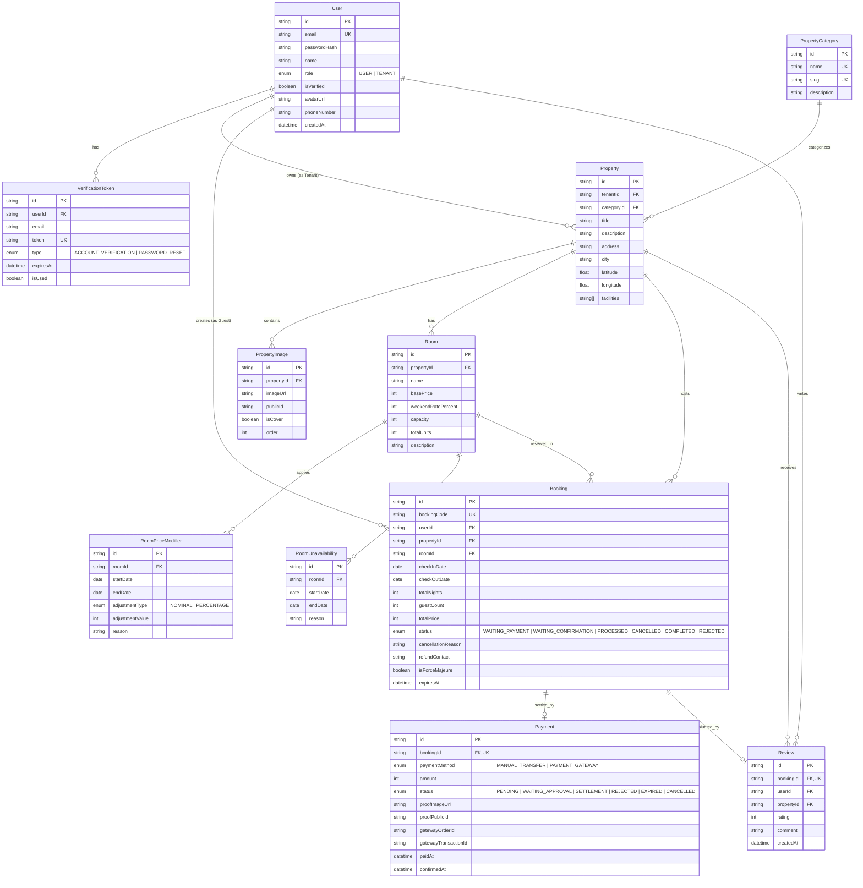
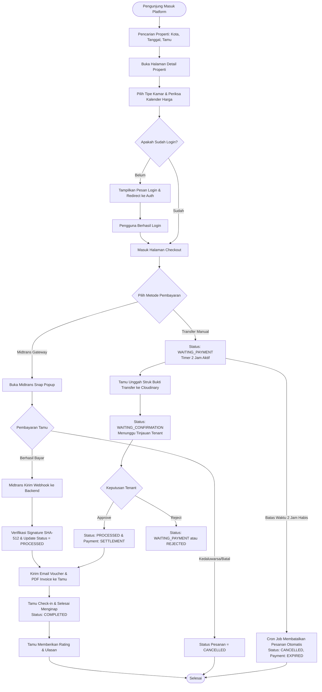

# MATERI PRESENTASI TEKNIKAL & ARSITEKTUR APLIKASI SINGGAHIN
**Platform Reservasi Penginapan & Manajemen Properti Berbasis Web Modern**

---

## DAFTAR ISI
1. [Ringkasan Eksekutif & Gambaran Umum Produk](#1-ringkasan-eksekutif--gambaran-umum-produk)
2. [Tech Stack & Arsitektur Teknologi](#2-tech-stack--arsitektur-teknologi)
3. [Aktor & Peran Pengguna (Actors & Roles)](#3-aktor--peran-pengguna-actors--roles)
4. [Functional & Non-Functional Requirements](#4-functional--non-functional-requirements)
5. [Domain Modul & Entitas Bisnis](#5-domain-modul--entitas-bisnis)
6. [Entity Relationship Diagram (ERD) & Alur Data](#6-entity-relationship-diagram-erd--alur-data)
7. [Flowchart Aplikasi & Business Process Logic](#7-flowchart-aplikasi--business-process-logic)
8. [Arsitektur Otentikasi & Manajemen Sesi (Auth Engine)](#8-arsitektur-otentikasi--manajemen-sesi-auth-engine)
9. [Sistem Notifikasi & Mailing Engine](#9-sistem-notifikasi--mailing-engine)
10. [Proses Pembayaran (Manual Transfer & Midtrans Gateway)](#10-proses-pembayaran-manual-transfer--midtrans-gateway)
11. [Teknis Kenaikan Harga Dinamis (Dynamic Pricing Engine)](#11-teknis-kenaikan-harga-dinamis-dynamic-pricing-engine)
12. [Branching Strategy & CI/CD Pipeline](#12-branching-strategy--cicd-pipeline)
13. [Strategi Pengujian & Kualitas Kode (Unit & Integration Testing)](#13-strategi-pengujian--kualitas-kode-unit--integration-testing)
14. [Infrastruktur Produksi: VPS, Domain, SSL, Nginx & Docker](#14-infrastruktur-produksi-vps-domain-ssl-nginx--docker)

---

## 1. RINGKASAN EKSEKUTIF & GAMBARAN UMUM PRODUK

### 1.1 Latar Belakang
**SinggahIn** adalah platform lokapasar akomodasi (*online travel & hospitality marketplace*) yang menghubungkan pemilik properti (**Tenant**) dengan pencari penginapan (**User/Guest**). Aplikasi ini memfasilitasi transaksi penyewaan hotel, vila, apartemen, homestay, dan guesthouse dengan sistem harga transparan, penyesuaian tarif dinamis berbasis musim liburan (*peak season*), serta integrasi multi-metode pembayaran modern di Indonesia.

### 1.2 Nilai Tambah Utama (Value Propositions)
1. **Transparansi Tarif & Kalender Interaktif**: Visualisasi harga kamar riil per malam secara interaktif 1 bulan penuh, termasuk kalkulasi otomatis biaya akhir pekan (*weekend surcharge*) dan lonjakan musim libur (*peak season modifier*).
2. **Kepatuhan Server-Side Penuh**: Paginasi, pencarian, dan pengurutan data diproses secara murni di sisi peladen (*server-side processing*) menggunakan query database terindeks untuk menjamin performa tinggi dan skalabilitas data besar.
3. **Otomatisasi Pembayaran Ganda**: Mendukung alur pembayaran transfer manual dengan verifikasi bukti transfer oleh Tenant, serta otomatisasi instan menggunakan *Payment Gateway* Midtrans (Virtual Account, QRIS, E-Wallet, Kartu Kredit).
4. **Keamanan & Kesiapan Produksi**: Proteksi sesi *stateless* berbasis JSON Web Token (JWT) yang disimpan di dalam *HTTP-only Secure Cookie*, perlindungan CSRF, enkripsi transit HTTPS via Nginx SSL Termination, serta arsitektur kontainerisasi Docker.

---

## 2. TECH STACK & ARSITEKTUR TEKNOLOGI

Aplikasi SinggahIn dirancang menggunakan arsitektur monorepo modular yang memisahkan antarmuka klien (*frontend*) dan peladen API (*backend*) dengan spesifikasi teknologi terkini:

```
+-----------------------------------------------------------------------------------+
|                                 CLIENT TIER                                       |
|  React 18 + Vite + TypeScript + Tailwind CSS + TanStack Query + Zustand           |
+-----------------------------------------------------------------------------------+
                                         |
                                         | HTTPS (Port 443 / SSL Let's Encrypt)
                                         v
+-----------------------------------------------------------------------------------+
|                              WEB SERVER & REVERSE PROXY                           |
|  Nginx Alpine (Reverse Proxy, SSL Termination, Gzip, Security Headers, Rate Limit)|
+-----------------------------------------------------------------------------------+
             |                                                  |
             | Proxy /                                          | Proxy /api/
             v                                                  v
+----------------------------------+   +--------------------------------------------+
|         FRONTEND CONTAINER       |   |             BACKEND CONTAINER              |
| Nginx Static File Serving (SPA)  |   | Node.js 20 + Express.js + TypeScript       |
| HTML5 History Mode Routing       |   | Prisma ORM + Zod Validation + PDFKit       |
+----------------------------------+   +--------------------------------------------+
                                                            |
                                                            | Prisma Client (TCP 5432)
                                                            v
+-----------------------------------------------------------------------------------+
|                                 DATA PERSISTENCE TIER                             |
|  PostgreSQL 16 Alpine (Relational Database, B-Tree Indexes, UUID/CUID Primary Keys)|
+-----------------------------------------------------------------------------------+
```

### 2.1 Frontend Stack
- **Framework & Runtime**: React 18 (SPA), TypeScript 5, Vite Build Tool.
- **Styling & UI Design**: Tailwind CSS, PostCSS, Lucide React (Icons).
- **Desain Komponen**: Pendekatan **Atomic Design** (`atoms`, `molecules`, `organisms`, `templates`, `pages`).
- **State Management**:
  - *Server State*: TanStack Query (React Query v5) untuk *caching*, *deduplication*, dan *background refetching*.
  - *Client State*: Zustand untuk status otentikasi global (`auth.store.ts`).
- **Peta & Geolocation**: Leaflet, React Leaflet, OpenStreetMap.
- **HTTP Client**: Axios (mendukung `withCredentials: true`, interceptor response untuk penanganan error terpusat).
- **Date Utility**: Date-fns (manipulasi tanggal lokal & UTC).

### 2.2 Backend Stack
- **Runtime & Framework**: Node.js 20 LTS, Express.js, TypeScript 5.
- **ORM & Database Driver**: Prisma ORM v5 dengan generator Linux Musl & Native.
- **Skema Validasi**: Zod (validasi ketat pada request `body`, `query`, dan `params`).
- **Otentikasi & Keamanan**:
  - `jsonwebtoken` (JWT) untuk penerbitan dan verifikasi token sesi.
  - `bcrypt` untuk *one-way cryptographic hashing* kata sandi.
  - `cookie-parser` untuk pengelolaan *HTTP-only cookies*.
- **Generasi Dokumen**: PDFKit (menghasilkan dokumen resmi invoice/voucher reservasi dalam bentuk PDF).
- **Cron Jobs**: Node-Cron untuk pembersihan pesanan kedaluwarsa secara terjadwal setiap 10 menit.
- **Mailing Engine**: Nodemailer (protokol SMTP) dengan template HTML responsif terstandar.

### 2.3 Layanan Pihak Ketiga (Third-Party Integrations)
- **Database**: PostgreSQL 16 Alpine.
- **Cloud Object Storage**: Cloudinary SDK (penyimpanan gambar properti, kamar, bukti transfer, dan avatar).
- **Payment Gateway**: Midtrans Snap API (Virtual Account Bank Mandiri, BCA, BNI, BRI, Permata, Gopay, QRIS, ShopeePay, Credit Card).
- **Reverse & Forward Geocoding**: OpenCage Data API (pencarian alamat otomatis & konversi koordinat GPS).

---

## 3. AKTOR & PERAN PENGGUNA (ACTORS & ROLES)

Sistem SinggahIn mengimplementasikan **Role-Based Access Control (RBAC)** dengan dua peran utama yang terdaftar pada skema basis data (`enum Role { USER, TENANT }`):

```
+------------------------------------------------------------------------------------+
|                                    AKTOR SISTEM                                    |
+--------------------+-------------------------------+-------------------------------+
|      GUEST         |        REGISTERED USER        |            TENANT             |
|   (Unauthenticated)|         (Role: USER)          |        (Role: TENANT)         |
+--------------------+-------------------------------+-------------------------------+
| * Jelajah Katalog  | * Seluruh fitur Guest         | * Mendaftarkan Penginapan     |
| * Cari Lokasi/Kota | * Reservasi Kamar             | * Kelola Tipe & Kuota Kamar   |
| * Kalender Harga   | * Pembayaran Manual/Midtrans  | * Setup Dynamic Price Rules   |
| * Baca Ulasan Tamu | * Riwayat & Status Pesanan    | * Blokir Tanggal Unavailability|
| * Registrasi Akun  | * Unduh Invoice PDF Resmi     | * Verifikasi Bukti Pembayaran |
| * Login ke Sistem  | * Beri Rating & Ulasan        | * Pembatalan Darurat (Kaharan)|
| * Lupa Password    | * Ganti Email & Password      | * Laporan Penjualan & Okupansi|
+--------------------+-------------------------------+-------------------------------+
```

### 3.1 Guest (Pengunjung Publik / Belum Terotentikasi)
- Menjelajahi katalog properti dengan pencarian berbasis kota, kategori akomodasi, kapasitas tamu, dan rentang tanggal.
- Mengamati detail properti: foto galeri beresolusi tinggi, daftar fasilitas, peta interaktif lokasi Leaflet, serta ulasan tamu.
- Memeriksa ketersediaan unit kamar dan harga harian pada kalender harga interaktif.
- Melakukan registrasi akun baru (memilih peran sebagai `USER` atau `TENANT`).
- Mengakses formulir permohonan reset password jika lupa kata sandi.

### 3.2 User (Penyewa / Tamu Terotentikasi)
- Melakukan pemesanan kamar (*checkout*) dengan tanggal check-in dan check-out yang valid.
- Memilih metode pembayaran: transfer bank manual atau *payment gateway* Midtrans Snap.
- Mengunggah foto struk bukti pembayaran manual dengan batasan waktu 2 jam.
- Memantau riwayat pesanan (*Order History*) dengan fitur filter status berbasis *badge*, pengurutan tanggal/harga, dan pencarian server-side.
- Mengunduh invoice resmi dalam format PDF berstandar cetak.
- Memberikan ulasan teks dan rating bintang (1-5) setelah menginap.
- Mengelola profil pribadi: pembaruan nama, nomor telepon, foto avatar Cloudinary, ubah kata sandi, dan permohonan penggantian alamat email dengan verifikasi token.

### 3.3 Tenant (Pemilik Properti / Pengelola Penginapan)
- Mendaftarkan dan mengedit penginapan: judul, deskripsi, alamat lengkap, kota, kategori, fasilitas, koordinat GPS (peta interaktif & *address autocomplete* OpenCage), serta galeri foto (menentukan foto sampul/cover).
- Mengelola tipe kamar: nama kamar, kapasitas ranjang/tamu, tarif dasar per malam (*base price*), persentase kenaikan akhir pekan (*weekend rate*), dan jumlah unit inventaris (*total units*).
- Mengatur aturan harga musiman (*Peak Season Price Modifier*): menambah atau mengurangi harga kamar secara persentase (%) atau nominal (Rp) pada rentang tanggal tertentu.
- Menetapkan blokir tanggal kamar (*Room Unavailability*): menutup kamar sementara untuk pemeliharaan fisik atau sewa offline.
- Memverifikasi transaksi masuk: memeriksa bukti transfer tamu, menyetujui (*Approve*) pesanan yang otomatis menerbitkan voucher ke email tamu, atau menolak (*Reject*) bukti transfer yang tidak valid.
- Menjalankan pembatalan darurat (*Emergency Cancellation / Force Majeure*): membatalkan pesanan yang telah dikonfirmasi dengan mencantumkan alasan spesifik dan kontak refund langsung ke email tamu.
- Mengakses laporan penjualan (*Sales Report*) dan kalender okupansi (*Occupancy Matrix*) harian/bulanan dengan visualisasi grafik interaktif.

---

## 4. FUNCTIONAL & NON-FUNCTIONAL REQUIREMENTS

### 4.1 Functional Requirements (FR)
| ID | Kategori | Deskripsi Kebutuhan Fungsional |
| :--- | :--- | :--- |
| **FR-AUTH-01** | Otentikasi | Registrasi akun baru dengan pengiriman tautan aktivasi email (kedaluwarsa 1 jam). |
| **FR-AUTH-02** | Otentikasi | Login menggunakan email dan kata sandi dengan penerbitan JWT di HTTP-only cookie. |
| **FR-AUTH-03** | Otentikasi | Reset password via tautan email sekali pakai (*single-use token*). |
| **FR-AUTH-04** | Profil | Perubahan email akun wajib melalui verifikasi konfirmasi pada email tujuan baru. |
| **FR-PROP-01** | Properti | Tenant dapat mengelola penginapan dengan koordinat latitude/longitude berbasis peta. |
| **FR-PROP-02** | Properti | Galeri multi-foto properti dengan Cloudinary (pengurutan foto & penetapan cover). |
| **FR-ROOM-01** | Kamar | Pengelolaan tipe kamar lengkap dengan inventaris unit fisik dan kapasitas tamu. |
| **FR-PRIC-01** | Dynamic Price | Kalkulasi harga otomatis memperhitungkan *weekend rate* dan *price modifiers*. |
| **FR-PRIC-02** | Dynamic Price | Resolusi konflik cerdas jika terdapat lebih dari satu aturan harga pada tanggal sama. |
| **FR-BOOK-01** | Reservasi | Validasi tumpang-tindih tanggal (*overlapping check*) terhadap kuota unit fisik kamar. |
| **FR-BOOK-02** | Reservasi | Batas waktu pembayaran transfer manual 2 jam dengan *countdown timer* real-time. |
| **FR-PAY-01** | Pembayaran | Pembayaran manual transfer dengan unggah bukti bayar & verifikasi oleh Tenant. |
| **FR-PAY-02** | Pembayaran | Integrasi Midtrans Snap dengan verifikasi signature webhook SHA-512 otomatis. |
| **FR-PAY-03** | Pembayaran | Otomatisasi generate dan pengiriman invoice PDF resmi saat pembayaran disetujui. |
| **FR-LIST-01** | Katalog & List| Semua tampilan daftar (properti, pesanan, riwayat) wajib diproses di server side. |
| **FR-REP-01** | Laporan | Visualisasi analitik pendapatan dan kalender okupansi properti untuk Tenant. |

### 4.2 Non-Functional Requirements (NFR)
1. **Security & Data Integrity**:
   - Kata sandi di-*hash* menggunakan algoritma *one-way* bcrypt dengan *salt rounds* standar industri.
   - Token sesi JWT tidak pernah disimpan di `localStorage` atau `sessionStorage` untuk memitigasi serangan **Cross-Site Scripting (XSS)**. Sesi disimpan di `Set-Cookie` dengan atribut `HttpOnly`, `SameSite=Lax`, dan `Secure` (saat HTTPS aktif).
   - Validasi data masukan di kedua sisi: klien (UX instan) dan peladen via Zod Schema (keamanan data integritas mutlak).
   - Verifikasi tanda tangan kriptografis SHA-512 pada webhook Midtrans untuk mencegah manipulasi status transaksi palsu.
2. **Performance & Scalability**:
   - Waktu respons API rata-rata di bawah 250ms untuk endpoint data utama berkat pengindeksan relasional pada PostgreSQL.
   - Paginasi server-side (`take` dan `skip`) membatasi beban memori dan transmisi payload jaringan.
   - Kompresi respons Nginx menggunakan modul `gzip` untuk aset teks, CSS, dan skrip JavaScript.
   - Optimasi gambar berbasis Cloudinary dengan transformasi format web modern (`webp`/`avif`).
3. **High Availability & Reliability**:
   - *Restart Policy* kontainer `unless-stopped` pada Docker Compose.
   - *Healthcheck* berkala pada kontainer PostgreSQL sebelum kontainer backend dijalankan (`service_healthy`).
   - Penanganan error sentralisasi pada Express middleware yang mengembalikan payload JSON terstandar (`{ success: false, message, errors }`) tanpa membocorkan *stack trace* internal ke pengguna publik.
4. **Maintainability & Clean Architecture**:
   - Pemisahan kode yang tegas antara *controller* (HTTP transport), *service* (business logic), *schema* (validasi kontrak Zod), dan *repository/Prisma* (akses data).
   - Komponen antarmuka modular mengikuti paradigma **Atomic Design**.

---

## 5. DOMAIN MODUL & ENTITAS BISNIS

Arsitektur aplikasi terbagi atas 6 modul domain utama yang terisolasi dan berorientasi layanan:

```
                      +----------------------------------+
                      |         IDENTITY MODULE          |
                      |  User, VerificationToken, RBAC   |
                      +----------------------------------+
                                       |
                +----------------------+----------------------+
                |                                             |
                v                                             v
+-------------------------------+             +-------------------------------+
|        PROPERTY MODULE        |             |        BOOKING MODULE         |
| Property, Category, Image, Map|             | Booking, Order Lifecycle, Cron|
+-------------------------------+             +-------------------------------+
                |                                             |
                v                                             v
+-------------------------------+             +-------------------------------+
|      ROOM & PRICING MODULE    |             |        PAYMENT MODULE         |
| Room, PriceModifier, Unavail  |             | Payment, Midtrans, Proof Mgmt |
+-------------------------------+             +-------------------------------+
                |                                             |
                +----------------------+----------------------+
                                       |
                                       v
                      +----------------------------------+
                      |     REVIEW & REPORT MODULE       |
                      | Review, Rating, Sales Analytics  |
                      +----------------------------------+
```

### 5.1 Modul Identity & Keamanan (`/modules/identity`)
- Bertanggung jawab atas siklus hidup pengguna: pendaftaran, pengiriman email aktivasi, otentikasi login, profil pengguna, perubahan email terverifikasi, dan reset kata sandi.
- Mengelola model `User` dan `VerificationToken`.

### 5.2 Modul Properti & Lokasi (`/modules/property`)
- Mengelola data master kategori properti (`PropertyCategory`), entitas fisik akomodasi (`Property`), galeri foto Cloudinary (`PropertyImage`), dan pencarian katalog properti publik.
- Mengintegrasikan OpenCage Geocoding untuk validasi alamat dan pemetaan koordinat GPS.

### 5.3 Modul Kamar & Penetapan Harga Dinamis (`/modules/room`)
- Mengelola tipe kamar fisik (`Room`), kuota unit kamar, aturan penyesuaian harga musiman (`RoomPriceModifier`), dan penutupan tanggal pemeliharaan (`RoomUnavailability`).
- Menghitung tarif riil harian (*Stay Pricing Calculation*) berdasarkan kombinasi hari kalender, akhir pekan, dan aturan lonjakan harga.

### 5.4 Modul Reservasi & Siklus Pesanan (`/modules/booking`)
- Mengorkestrasi pembuatan pesanan baru (`Booking`), verifikasi tumpang-tindih tanggal terhadap unit kamar yang tersisa, penguncian transaksi database Prisma (`$transaction`), dan pembatalan pesanan.
- Memproses cron job otomatis untuk pembatalan pesanan yang melewati batas waktu 2 jam.

### 5.5 Modul Pembayaran & Integrasi Gateway (`/modules/payment`)
- Mengelola entitas transaksi pembayaran (`Payment`).
- Memfasilitasi alur verifikasi bukti transfer manual oleh Tenant.
- Mengintegrasikan Midtrans Snap API, pembuatan token pembayaran, penanganan webhook notifikasi instan, serta sinkronisasi status gateway berkala.

### 5.6 Modul Ulasan & Laporan Bisnis (`/modules/review`, `/modules/report`)
- Mengelola ulasan dan rating bintang pasca-menginap (`Review`) yang diverifikasi hanya dapat dibuat oleh pemesan sah setelah status pesanan selesai (`COMPLETED`).
- Menyajikan komputasi agregasi metrik pendapatan (*revenue*), rata-rata nilai transaksi, dan tingkat okupansi kamar (*occupancy rate*) untuk dasbor analitik Tenant.

---

## 6. ENTITY RELATIONSHIP DIAGRAM (ERD) & ALUR DATA

### 6.1 Diagram ERD (Mermaid Entity-Relationship Diagram)



### 6.2 Alur Data & Indeks Basis Data Utama
Untuk mendukung query cepat berkapasitas besar:
1. `bookings`: Menggunakan indeks komposit `@@index([checkInDate, checkOutDate, roomId, status])` untuk mempercepat kalkulasi kuota kamar yang tersedia secara instan saat pencarian.
2. `properties`: Menggunakan indeks komposit `@@index([city, categoryId])` untuk mempercepat pemfilteran katalog di sisi peladen.
3. `room_price_modifiers` & `room_unavailabilities`: Menggunakan indeks rentang `@@index([roomId, startDate, endDate])` untuk evaluasi harga dinamis tanpa pemindaian tabel penuh (*full-table scan*).

---

## 7. FLOWCHART APLIKASI & BUSINESS PROCESS LOGIC

### 7.1 Alur Pengalaman Tamu (Guest Booking & Payment Journey)



---

## 8. ARSITEKTUR OTENTIKASI & MANAJEMEN SESI (AUTH ENGINE)

### 8.1 Alur Registrasi & Verifikasi Akun Baru
```
1. Guest input data registrasi (email, password, nama, role: USER/TENANT).
2. Backend memvalidasi input via Zod Schema.
3. Password di-hash menggunakan bcrypt (salt rounds = 10).
4. User disimpan di database dengan status isVerified = false.
5. Backend membuat VerificationToken bertipe ACCOUNT_VERIFICATION (CUID, berlaku 1 jam).
6. Nodemailer mengirim email aktivasi berisi tautan: ${CLIENT_URL}/verify?token=${token}.
7. Pengguna mengklik tautan di email -> Frontend memanggil POST /api/v1/auth/verify.
8. Backend memvalidasi token, menandai isUsed = true, dan mengubah isVerified = true.
```

### 8.2 Alur Login & Manajemen Sesi (HttpOnly Secure Cookie)
Untuk mencegah serangan pencurian token melalui celah Cross-Site Scripting (XSS), SinggahIn menerapkan arsitektur sesi modern berbasis cookie:
- **Penerbitan Token**: Saat login berhasil via `POST /api/v1/auth/login`, backend membuat JWT yang memuat klaim `{ userId, email, role }` dengan masa berlaku 1 hari (`JWT_EXPIRES_IN=1d`).
- **Penyimpanan**: Backend mengirim header `Set-Cookie`:
  ```http
  Set-Cookie: token=<jwt_token>; Max-Age=86400; Path=/; HttpOnly; SameSite=Lax; Secure
  ```
  - `HttpOnly`: Mencegah JavaScript di peramban membaca token melalui `document.cookie`.
  - `SameSite=Lax`: Mencegah pengiriman token pada serangan Cross-Site Request Forgery (CSRF) dari situs eksternal.
  - `Secure`: Memastikan cookie hanya ditransmisikan melalui kanal terenkripsi HTTPS.
- **Verifikasi Middleware (`authenticate`)**:
  Setiap request yang membutuhkan otorisasi akan diekstrak tokennya dari `req.cookies.token` atau header `Authorization: Bearer <token>`.
  Payload token didekode dan disematkan ke objek `req.user`.
- **Pengecekan Akses Peran (`requireRole`)**:
  Endpoint tenant dilindungi oleh middleware `requireRole(Role.TENANT)`. Jika pengguna yang masuk memiliki peran `USER`, request langsung ditolak dengan status HTTP 403 Forbidden.

### 8.3 Alur Reset Password (Forgot Password)
```
1. Pengguna meminta reset password via POST /api/v1/auth/forgot-password dengan email.
2. Backend mencari user di database (jika email tidak terdaftar, tetap mengembalikan respons sukses generik untuk mencegah user enumeration attack).
3. Backend membuat VerificationToken bertipe PASSWORD_RESET (berlaku 1 jam, single-use).
4. Nodemailer mengirim email berisi tautan: ${CLIENT_URL}/reset-password?token=${token}.
5. Pengguna memasukkan kata sandi baru -> POST /api/v1/auth/reset-password.
6. Backend memvalidasi token, meng-hash kata sandi baru, dan menandai token isUsed = true.
```

### 8.4 Alur Ganti Email Akun (Email Change Verification)
Untuk mencegah pengambilalihan akun via penggantian email sepihak:
```
1. Pengguna terotentikasi meminta perubahan email via PATCH /api/v1/profile/email dengan emailBaru.
2. Backend memeriksa bahwa emailBaru belum digunakan oleh akun lain.
3. Backend membuat VerificationToken khusus yang mengikat userId dengan alamat emailBaru.
4. Email konfirmasi dikirim ke ALAMAT EMAIL BARU (bukan email lama).
5. Pengguna membuka inbox email baru dan mengklik tautan konfirmasi.
6. Endpoint verifikasi dijalankan -> email pengguna resmi diperbarui ke alamat baru.
```

---

## 9. SISTEM NOTIFIKASI & MAILING ENGINE

### 9.1 Infrastruktur Nodemailer
Layanan email diimplementasikan pada peladen terpusat di `backend/src/shared/services/mail.service.ts`:
- **Transporter**: Terhubung ke peladen SMTP (misal: Gmail SMTP / Mailgun / AWS SES) menggunakan enkripsi TLS Port 587/465.
- **Branded HTML Template**: Menggunakan tata letak responsif bertema SinggahIn dengan warna aksen biru laut, logo resmi, kontainer terpusat, tombol aksi tebal, dan *notice box* keamanan.

### 9.2 Skenario Pengiriman Email Transaksional
1. **Aktivasi Akun Baru** (`sendVerificationEmail`): Tautan aktivasi akun berbatas waktu 1 jam.
2. **Reset Kata Sandi** (`sendPasswordResetEmail`): Tautan pemulihan akun berbatas waktu 1 jam.
3. **Konfirmasi Pembaruan Email** (`sendEmailChangeVerificationEmail`): Tautan validasi kepemilikan email baru.
4. **Bukti Pembayaran & Voucher Reservasi** (`sendBookingVoucherEmail`):
   - Dikirim otomatis saat pembayaran Midtrans berstatus `SETTLEMENT` atau pembayaran manual disetujui Tenant (`Approve`).
   - Menyertakan lampiran file dokumen **PDF Invoice resmi** yang digenerate langsung oleh backend menggunakan pustaka `pdfkit`.
   - Dokumen mencantumkan detail kode booking, nama tamu, tanggal check-in/out, ringkasan biaya, serta panduan check-in properti.
5. **Pemberitahuan Pembatalan Darurat** (`sendEmergencyCancellationEmail`):
   - Dikirim saat Tenant terpaksa membatalkan pesanan yang telah dikonfirmasi akibat *force majeure* atau kerusakan mendadak.
   - Memuat kode booking, nama properti, alasan pembatalan Tenant, dan nomor kontak langsung pengembalian dana (*refund*).

---

## 10. PROSES PEMBAYARAN (MANUAL TRANSFER & MIDTRANS GATEWAY)

### 10.1 Alur Pembayaran Transfer Bank Manual
1. **Pembuatan Pesanan**: Tamu menyelesaikan checkout dan memilih metode `MANUAL_TRANSFER`. Status pesanan: `WAITING_PAYMENT`, status pembayaran: `PENDING`. Batas waktu pembayaran diatur 2 jam dari waktu pembuatan (`expiresAt = now + 2 jam`).
2. **Unggah Bukti Bayar**:
   - Tamu mengunggah berkas gambar struk/mutasi bank (JPEG/PNG/WebP, maksimal 5MB) ke antarmuka aplikasi.
   - Berkas diunggah secara aman ke Cloudinary melalui endpoint `POST /api/v1/payments/:bookingId/upload-proof`.
   - Status pesanan berpindah menjadi `WAITING_CONFIRMATION` dan status pembayaran menjadi `WAITING_APPROVAL`.
3. **Tinjauan Tenant**:
   - Tenant membuka dasbor *Kelola Pesanan Masuk*.
   - Tenant dapat melihat detail transaksi dan gambar bukti transfer secara langsung.
   - **Tindakan Approve**: Tenant mengonfirmasi keabsahan dana. Status pesanan berubah menjadi `PROCESSED`, pembayaran menjadi `SETTLEMENT`. Backend memicu generasi voucher PDF dan pengiriman email otomatis ke tamu.
   - **Tindakan Reject**: Jika struk palsu/tidak terbaca, Tenant menolak transaksi dengan mencantumkan alasan. Status pesanan kembali ke `WAITING_PAYMENT` agar tamu dapat mengunggah ulang bukti bayar sebelum masa 2 jam habis.

### 10.2 Alur Pembayaran Otomatis Midtrans Gateway
1. **Inisialisasi Transaksi**:
   - Tamu memilih metode `PAYMENT_GATEWAY`.
   - Backend memanggil Midtrans Snap API `createTransaction`:
     - `order_id`: Kode pesanan unik (`bookingCode`).
     - `gross_amount`: Total harga reservasi.
     - `customer_details`: Nama dan email pengguna.
   - Midtrans merespons dengan `token` snap dan `redirect_url`.
2. **Interaksi Antarmuka Klien**:
   - Frontend memanggil fungsi `window.snap.pay(snapToken)` untuk memunculkan modal pembayaran interaktif.
   - Tamu dapat memilih Virtual Account (BCA, Mandiri, BNI, BRI), GoPay, ShopeePay, atau QRIS.
3. **Penanganan Webhook Notifikasi Server-to-Server**:
   - Saat tamu menyelesaikan transfer di bank/e-wallet, peladen Midtrans mengirimkan HTTP POST ke endpoint publik `/api/v1/payments/midtrans/webhook`.
   - **Verifikasi Signature Hash**:
     ```typescript
     const expectedSignature = crypto
       .createHash('sha512')
       .update(`${orderId}${statusCode}${grossAmount}${serverKey}`)
       .digest('hex');
     ```
     Jika tanda tangan cocok, backend memperbarui status transaksi secara atomik dalam database:
     - `settlement` atau `capture` (fraud_status: `accept`) -> Pesanan `PROCESSED`, Pembayaran `SETTLEMENT`, kirim voucher email.
     - `expire` -> Pesanan `CANCELLED`, Pembayaran `EXPIRED`.
     - `cancel` atau `deny` -> Pesanan `CANCELLED`, Pembayaran `CANCELLED`.
4. **Sinkronisasi Otomatis (*On-Demand Sync*)**:
   - Jika webhook terhambat oleh jaringan eksternal, sistem menyediakan mekanisme polling cerdas yang langsung memanggil status API Midtrans ketika tamu membuka halaman detail pesanan.

### 10.3 Otomatisasi Pembersihan Transaksi Kedaluwarsa (Cron Job)
- Skrip latar belakang `booking.cron.ts` berjalan secara berkala menggunakan `node-cron`:
  ```sql
  UPDATE bookings 
  SET status = 'CANCELLED' 
  WHERE status = 'WAITING_PAYMENT' AND expiresAt < NOW();
  ```
- Pembatalan otomatis melepaskan alokasi unit kamar kembali ke inventaris publik sehingga kamar dapat dipesan oleh tamu lain.

---

## 11. TEKNIS KENAIKAN HARGA DINAMIS (DYNAMIC PRICING ENGINE)

SinggahIn memiliki mesin penetapan harga kamar harian (*Daily Stay Pricing Engine*) di `backend/src/modules/room/pricing.service.ts` dan `pricing.helper.ts` yang memperhitungkan variasi tanggal menginap secara presisi:

```
[Tarif Dasar Kamar / Base Price] (misal: Rp 500.000)
              |
              v
[Apakah Ada Aturan Peak Season Modifier Aktif pada Tanggal Tersebut?]
       |                                              |
      YA                                            TIDAK
       |                                              |
       v                                              v
Terapkan Modifier Pemenang:                  [Apakah Tanggal Tersebut Weekend?]
- PERSENTASE: Base * (1 + Val/100)                    |               |
- NOMINAL: Base + Val                                YA             TIDAK
                                                      |               |
                                                      v               v
                                            Base * (1 + Weekend%)  Base Price
```

### 11.1 Komponen Pembentuk Tarif
1. **Base Price**: Harga patokan standar kamar per malam yang ditentukan oleh Tenant.
2. **Weekend Rate Surcharge**: Persentase tambahan biaya otomatis untuk hari Sabtu dan Minggu (misal: `+15%` untuk akhir pekan).
3. **Peak Season Price Modifier**: Aturan lonjakan atau diskon harga yang diterapkan Tenant untuk rentang tanggal tertentu (misal: Libur Idul Fitri, Tahun Baru):
   - Tipe Penyesuaian `PERCENTAGE`: Menambah persentase (misal `+25%`).
   - Tipe Penyesuaian `NOMINAL`: Menambah nominal tetap (misal `+Rp 150.000`).

### 11.2 Algoritma Resolusi Konflik Multi-Modifier
Jika pada suatu tanggal tertentu terdapat lebih dari satu aturan modifier harga yang aktif secara bersamaan, algoritma `compareModifiers()` mengevaluasi prioritas pemenang dengan aturan deterministik:
1. **Durasi Terpendek (*Shortest Duration First*)**: Aturan dengan rentang hari lebih sempit/spesifik diprioritaskan daripada aturan libur jangka panjang (misal: aturan promosi khusus 2 hari mengalahkan aturan libur 30 hari).
2. **Nilai Tarif Tertinggi (*Highest Effective Price*)**: Jika durasi kedua aturan persis sama, aturan yang menghasilkan harga akhir lebih tinggi yang dimenangkan.
3. **Aturan Terkini (*Latest Created Timestamp*)**: Jika harga yang dihasilkan tetap sama, aturan yang paling baru dibuat (`createdAt`) yang dipilih.

### 11.3 Kalkulasi Agregasi Reservasi Multi-Malam
Untuk reservasi rentang `checkInDate` sampai `checkOutDate`:
- Peladen menghasilkan rentang hari secara diskret dalam format tanggal UTC (`generateDateRange`).
- Setiap malam dihitung tarif efektifnya masing-masing (`DailyPriceDto`).
- Total biaya menginap dihitung dengan menjumlahkan seluruh harga efektif harian:
  $$\text{Total Stay Price} = \sum_{i=1}^{N} \text{EffectivePrice}_i$$
- Rata-rata tarif per malam dihitung sebagai dasar pertimbangan transparansi tamu:
  $$\text{Average Night Rate} = \text{Round}\left(\frac{\text{Total Stay Price}}{N}\right)$$

---

## 12. BRANCHING STRATEGY & CI/CD PIPELINE

### 12.1 Strategi Percabangan Git (Git Branching Flow)
Pengembangan kode SinggahIn mengadopsi model **Git Flow** terstruktur:
- **`main`**: Cabang rilis produksi (*Production-ready code*). Kode stabil yang siap dideploy ke publik.
- **`develop`**: Cabang integrasi utama (*Staging branch*). Seluruh fitur yang selesai dikembangkan digabungkan ke cabang ini untuk pengujian terintegrasi.
- **Feature Branches (`SCRUM-<NO>-<NAMA-FITUR>`)**:
  Setiap *task/ticket* dikerjakan dalam cabang terisolasi dari `develop`, misalnya:
  - `SCRUM-39-Comprehensive-Bug-Fixing-Clean-Code-Audit`
  - `SCRUM-35-Frontend-User-Checkout-Interface`
  - `SCRUM-28-Frontend-Property-Card-Catalog-Search-Page`
  - `SCRUM-59-Screen-Should-Scroll-to-date-picker`
- Setiap fitur diselesaikan melalui mekanisme **Pull Request (PR)** dengan audit konsistensi dan verifikasi lulus pengujian otomatis.

### 12.2 Otomatisasi CI/CD Pipeline (GitHub Actions)
Pipeline deployment otomatis didefinisikan pada `.github/workflows/deploy.yml` dan terpicu saat terjadi `push` ke cabang `develop`:

```mermaid
flowchart LR
    Push[Push ke develop] --> Job1[Job 1: Build & Push Images]
    
    subgraph Job 1: GitHub Runner
        Job1 --> Checkout1[Checkout Code]
        Checkout1 --> Buildx[Setup Docker Buildx]
        Buildx --> LoginGHCR[Login ke ghcr.io]
        LoginGHCR --> BuildBE[Build & Push singgahin-backend:latest]
        LoginGHCR --> BuildFE[Build & Push singgahin-frontend:latest]
    end
    
    BuildBE --> Job2[Job 2: Deploy to VPS]
    BuildFE --> Job2
    
    subgraph Job 2: VPS SSH
        Job2 --> SCP[SCP: Copy docker-compose.prod.yml & nginx config]
        SCP --> SSH[SSH: Eksekusi Perintah Deployment]
        SSH --> Pull[docker compose pull latest images]
        Pull --> Up[docker compose up -d --remove-orphans]
        Up --> Migrate[npx prisma db push]
        Migrate --> Prune[docker image prune -af]
    end
    
    Prune --> Live([Aplikasi Live di singgahin.biz.id])
```



#### Langkah-langkah Otomatisasi Pipeline:
1. **Build & Push (GitHub Runner)**:
   - Kode divalidasi dan dibangun menjadi *image* kontainer Docker secara multi-stage.
   - Pemanfaatan *GitHub Actions Cache* (`type=gha,mode=max`) mempercepat waktu pembangunan kontainer dari 10 menit menjadi di bawah 2 menit.
   - *Image* kontainer yang selesai dibangun diunggah ke **GitHub Container Registry (GHCR)**:
     - `ghcr.io/papuadev/singgahin-backend:latest`
     - `ghcr.io/papuadev/singgahin-frontend:latest`
2. **Deploy to VPS (SSH Action)**:
   - Berkas konfigurasi `docker-compose.prod.yml` dan `nginx/conf.d/default.conf` dikirim ke VPS via protokol SCP (`appleboy/scp-action`).
   - GitHub Actions terhubung ke VPS melalui SSH (`appleboy/ssh-action` menggunakan SSH Private Key rahasia).
   - VPS menarik *image* kontainer terbaru dari GHCR.
   - Kontainer diperbarui tanpa downtime berlebih (`docker compose up -d --remove-orphans`).
   - Eksekusi migrasi skema basis data secara otomatis: `docker compose exec -T backend npx prisma db push`.
   - Pembersihan berkas *image* usang (`docker image prune -af`) untuk mencegah kehabisan kapasitas SSD VPS.

---

## 13. STRATEGI PENGUJIAN & KUALITAS KODE (UNIT & INTEGRATION TESTING)

Kualitas dan ketahanan kode dijamin melalui rangkaian pengujian komprehensif menggunakan ekosistem **Vitest**:

### 13.1 Hasil Pengujian Saat Ini
```
+------------------------------------------------------------------------------------+
|                         RINGKASAN STATUS TESTING APLIKASI                          |
+----------------------+--------------------+--------------------+-------------------+
|     KOMPONEN         | TOTAL TEST FILES   | TOTAL TESTS        | HASIL AKHIR       |
+----------------------+--------------------+--------------------+-------------------+
| Backend (Node/Prisma)| 55 Test Files      | 443 Tests          | 100% PASSED (0 F) |
| Frontend (React/SPA) | 85 Test Files      | 493 Tests          | 100% PASSED (0 F) |
+----------------------+--------------------+--------------------+-------------------+
| TOTAL KESELURUHAN    | 140 Test Files     | 936 Tests          | 100% LULUS LENGKAP|
+----------------------+--------------------+--------------------+-------------------+
```

### 13.2 Lingkup Pengujian Backend
- **Schema Validation Tests**: Menguji validitas Zod schema terhadap kasus payload valid, invalid format, batas karakter, serta serangan injeksi tipe data.
- **Service & Business Logic Tests**:
  - Algoritma penetapan harga kamar dan resolusi konflik modifier (`pricing.helper.test.ts`).
  - Siklus reservasi, penguncian inventaris kamar, dan cron job kedaluwarsa pesanan (`booking.service.test.ts`, `booking-cron.service.test.ts`).
  - Verifikasi keamanan berkas gambar dan token (`image-security.util.test.ts`, `token.service.test.ts`).
- **Integration Tests**: Menguji alur HTTP terintegrasi Supertest terhadap endpoint otentikasi, katalog properti, ulasan, pembayaran, dan pelaporan keuangan.

### 13.3 Lingkup Pengujian Frontend
- **Atomic Molecule Tests**: Pengujian molekul independen seperti [`Pagination.test.tsx`](file:///home/aliwpurbo/Code/Purwadhika/SinggahIn/frontend/src/components/molecules/__tests__/Pagination.test.tsx) yang memvalidasi navigasi tombol halaman, pemangkasan ellipsis (`...`), serta atribut aksesibilitas.
- **Hook Isolation Tests**: Pengujian logika stateful non-UI seperti [`useDebounce.test.ts`](file:///home/aliwpurbo/Code/Purwadhika/SinggahIn/frontend/src/libs/__tests__/useDebounce.test.ts) dan [`useServerRoomListFilter.test.tsx`](file:///home/aliwpurbo/Code/Purwadhika/SinggahIn/frontend/src/modules/room/__tests__/useServerRoomListFilter.test.tsx).
- **Page Integration Tests**: Pengujian rendering halaman lengkap dengan simulasi interaksi pengguna menggunakan `@testing-library/react` dan mock server `@tanstack/react-query`:
  - [`TenantPropertyListPage.test.tsx`](file:///home/aliwpurbo/Code/Purwadhika/SinggahIn/frontend/src/pages/tenant/__tests__/TenantPropertyListPage.test.tsx)
  - [`TenantOrderManagementPage.test.tsx`](file:///home/aliwpurbo/Code/Purwadhika/SinggahIn/frontend/src/pages/tenant/__tests__/TenantOrderManagementPage.test.tsx)
  - [`OrderHistoryPage.test.tsx`](file:///home/aliwpurbo/Code/Purwadhika/SinggahIn/frontend/src/pages/__tests__/OrderHistoryPage.test.tsx)
  - [`PropertyDetailPage.test.tsx`](file:///home/aliwpurbo/Code/Purwadhika/SinggahIn/frontend/src/pages/__tests__/PropertyDetailPage.test.tsx)

---

## 14. INFRASTRUKTUR PRODUKSI: VPS, DOMAIN, SSL, NGINX & DOCKER

### 14.1 Topologi Infrastruktur Server VPS
Aplikasi di-deploy pada VPS berbasis Linux (Ubuntu Server) dengan spesifikasi yang dioptimasi untuk arsitektur kontainer mikro:
- **Alamat Domain Publik**: `https://singgahin.biz.id` dan `https://www.singgahin.biz.id`.
- **Topologi Jaringan Virtual Docker**:
  Semua kontainer terhubung dalam *bridge network* privat bernama `singgahin-network`. Port internal kontainer backend (`5000`) dan database (`5432`) tidak terekspos langsung ke internet publik demi keamanan data. Hanya Nginx yang mengekspos Port `80` (HTTP) dan Port `443` (HTTPS) ke internet.

```
                          INTERNET (Publik)
                                 |
                        Port 80 / Port 443
                                 v
+-------------------------------------------------------------------+
| VPS HOST                                                          |
|                                                                   |
|   +-----------------------------------------------------------+   |
|   | singgahin-nginx-proxy (Nginx Alpine)                      |   |
|   | - SSL Termination (Let's Encrypt / Certbot)               |   |
|   | - HTTP -> HTTPS 301 Permanent Redirect                    |   |
|   | - Gzip Compression & Security Headers                     |   |
|   +-----------------------------------------------------------+   |
|                     |                       |                     |
|           proxy_pass http://frontend:80     | proxy_pass http://backend:5000
|                     v                       v                     |
|   +-----------------------+   +-------------------------------+   |
|   | singgahin-frontend    |   | singgahin-backend             |   |
|   | (Static Nginx SPA)    |   | (Node.js Express + Prisma)    |   |
|   +-----------------------+   +-------------------------------+   |
|                                             |                     |
|                                  TCP 5432 (Internal Network)      |
|                                             v                     |
|                               +-------------------------------+   |
|                               | singgahin-postgres            |   |
|                               | (PostgreSQL 16 Alpine)        |   |
|                               | Volume: singgahin_postgres_   |   |
|                               | data (Persistent Storage)     |   |
|                               +-------------------------------+   |
+-------------------------------------------------------------------+
```

### 14.2 Konfigurasi Nginx Reverse Proxy & Keamanan (`nginx/conf.d/default.conf`)
1. **Blok Server HTTP (Port 80)**:
   - Melayani tantangan ACME Let's Encrypt untuk sertifikat SSL otomatis pada lokasi `/.well-known/acme-challenge/`.
   - Mengalihkan (*redirect*) seluruh lalu lintas HTTP ke HTTPS secara permanen dengan kode status HTTP 301:
     ```nginx
     location / {
         return 301 https://$host$request_uri;
     }
     ```
2. **Blok Server HTTPS (Port 443)**:
   - **Terminasi SSL**: Menggunakan berkas sertifikat `/etc/letsencrypt/live/singgahin.biz.id/fullchain.pem` dan kunci privat `privkey.pem`.
   - **Protokol Kuat**: Membatasi komunikasi hanya pada TLSv1.2 dan TLSv1.3 dengan rangkaian sandi (*cipher suite*) ECDHE modern.
   - **Security Headers Aktif**:
     - `Strict-Transport-Security "max-age=31536000; includeSubDomains"` (HSTS).
     - `X-Frame-Options SAMEORIGIN` (Mencegah serangan Clickjacking).
     - `X-Content-Type-Options nosniff` (Mencegah MIME-sniffing exploit).
     - `X-XSS-Protection "1; mode=block"`.
   - **Reverse Proxy `/api/`**:
     Mengalirkan request API ke kontainer `backend:5000` dengan meneruskan header identitas klien asli (`X-Real-IP`, `X-Forwarded-For`, `X-Forwarded-Proto`).
   - **Reverse Proxy `/`**:
     Mengalirkan request antarmuka ke kontainer `frontend:80` untuk melayani berkas statis Single Page Application.

### 14.3 Otomatisasi Sertifikat SSL (Certbot Let's Encrypt)
- Menggunakan kontainer Certbot dengan mekanisme *Webroot Challenge*:
  Berkas tantangan ACME disimpan di volume bersama `./certbot/www` yang dapat dibaca langsung oleh Nginx pada Port 80.
- Pembaruan sertifikat otomatis dijalankan secara periodik tanpa memutus operasional aplikasi.

---

## 15. KESIMPULAN

Aplikasi **SinggahIn** telah dibangun dengan standar rekayasa perangkat lunak modern yang mengedepankan:
1. **Keamanan Maksimal**: Otentikasi berbasis HttpOnly cookie, otorisasi RBAC berlapis, dan enkripsi SSL end-to-end.
2. **Performa Tinggi**: Seluruh penyaringan, pencarian, dan paginasi data diproses 100% di sisi peladen (*server-side processing*) dengan optimasi query database terindeks.
3. **Desain Komponen Bersih**: Implementasi pola Atomic Design pada frontend dengan penyeragaman komponen Pagination dan sticky header.
4. **Otomatisasi Penuh**: Alur pembayaran ganda (Manual & Midtrans Webhook), pengiriman voucher invoice PDF otomatis via SMTP, serta deployment terotomatisasi dari GitHub ke VPS menggunakan Docker CI/CD.
5. **Kualitas Teruji**: 140 berkas pengujian dengan 936 unit dan integration tests yang lulus 100% tanpa regresi.

---
*Dokumen ini disusun sebagai materi presentasi resmi arsitektur teknikal dan demonstrasi aplikasi SinggahIn.*
